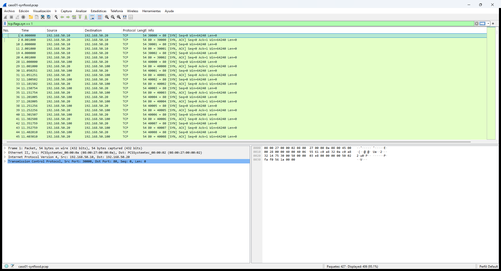
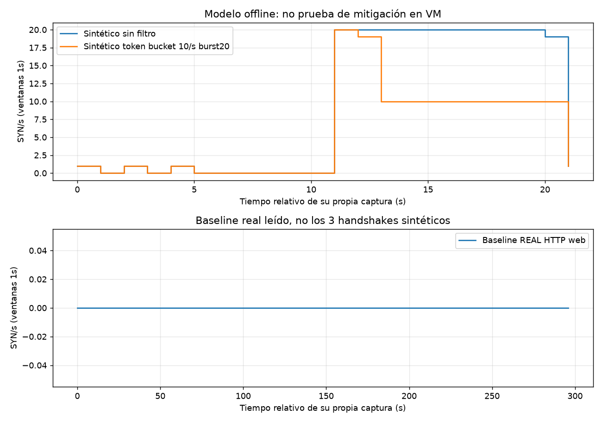

# Ficha PROVISIONAL — CASO-01: SYN y límite de tasa simulado

Nueve campos y preguntas propuestos; no transcripción de la guía original.

1. **ID:** CASO-01.
2. **Título:** Ráfaga SYN sin handshake completo, modelada offline.
3. **Fecha y analista:** 2026-11-18; revisión del laboratorio autorizado.
4. **Categoría:** Estudio TCP/DoS; simulación, no incidente demostrado.
5. **Descripción:** 200 SYN de `.100` hacia `.20:80`, más 3 conexiones HTTP
   sintéticas completas. El segundo PCAP modela un token bucket 10/s,
   burst20 inicialmente lleno: deja pasar 120 de los 200 SYN y descarta 80.
   Los paquetes aceptados están distribuidos durante los 10 s, incluida la
   segunda mitad; no se elimina simplemente esa mitad de la captura.
6. **Severidad:** Alta potencial para agotamiento bajo otras condiciones;
   aquí no se midieron recursos, indisponibilidad ni impacto lateral.
7. **Evidencias:** `evidencia/casos/caso01-synflood.pcap`,
   `caso01-synflood-ratelimit.pcap`, `caso01-analisis.txt`, `caso01-syn-rate.png`
   (sintéticos/derivados); `evidencia/baseline-normal.pcapng` y
   `caso01-netstat-host.txt` (reales, históricos); `caso01-regla.nft` (propuesta).
8. **Observables:** sin filtro: SYN=203, SYN-ACK=203, ACK sin SYN/FIN/RST=15,
   FIN=6; TCP=427. Con bucket: 123, 123, 15, 6; TCP=267.
   Correlación: 3 handshakes completos en ambos; 200/120 intentos únicos
   sin finalización observada. No se infiere estado SYN_RECEIVED real.
9. **Estado:** Patrón sintético confirmado por el generador; ataque real y
   eficacia de mitigación no probados.

## Indicadores y análisis

Ejecutar offline `scripts/gen_caso01_synflood.py` y `scripts/analizar_caso01.py`.
Categorías excluyentes: RST, SYN-ACK, SYN, FIN, ACK restante, otros. ACK de datos
no equivale a tercer paso del handshake. Este se correlaciona por stream,
4-tupla, seq/ack **raw**, orden temporal y timeout 10 s, deduplicando retransmisiones.

Ventanas de 1 s desde el inicio de cada captura, incluyendo silencios y última
ventana potencialmente parcial. La ráfaga sin filtro alcanza 20 SYN/ventana;
con burst20 también puede alcanzar 20 inicialmente: 10/s no es un techo estricto
por cada ventana aislada. La captura completa dura 21.001 s y no debe usarse
su media como tasa de la ráfaga de 10 s.

**Baseline real leído:** 296.670161 s, filtro
`tcp && ip.addr == 192.168.50.20 && tcp.port == 80`: 57 segmentos TCP, 0 SYN y
0 handshakes correlacionables. La captura puede comenzar con sesiones ya
existentes; esto NO implica ausencia de HTTP ni una línea base normal de 1 SYN/s.
No permite calibrar un umbral universal de establecimiento. Los 3 handshakes
del guion no son baseline real. El netstat del host no recibe tráfico sintético.

## Controles propuestos

`caso01-regla.nft`: tabla independiente `caso01_syn`, hook input **en web .20**,
policy accept; descarta solo HTTP SYN en exceso mediante
`limit rate over 10/second burst 20 packets counter drop`.
Sin `over`, la selección quedaría invertida. Bucket agregado, no por origen.
No se aplica: revisar interacción con otras tablas, carga legítima y syncookies.
El gateway `.1` no protege a `.20` del tráfico directo de peers de la misma subred.

Validación: `nft -c -f /dev/stdin`, nftables 1.0.9 disponible por SSH en gateway,
exit0, stdout/stderr vacíos; **solo comprobación sin aplicación**, no prueba
funcional en web ni demostración de que evita agotamiento.

## Preguntas PROPUESTAS (no originales de la guía)

- **¿Basta contar ACK?** No: SYN-ACK y datos tienen ACK; correlacionar el handshake.
- **¿Qué demuestra el segundo PCAP?** El comportamiento del modelo token bucket,
  no que nftables filtró tráfico real o que el servicio mantuvo disponibilidad.
- **¿Puede inferirse un umbral de ataque?** No con este baseline sin inicios HTTP.

## Trazabilidad y evidencia visual

Versiones anteriores conservadas byte a byte en `evidencia/casos/revision-anterior/`.
Hashes finales en el manifiesto de cierre y bloque anexado a `evidencia.log`,
sin borrar su historial. `caso01-wireshark.png` es histórico; el pantallazo
vigente muestra el PCAP sintético corregido, no tráfico transmitido.

