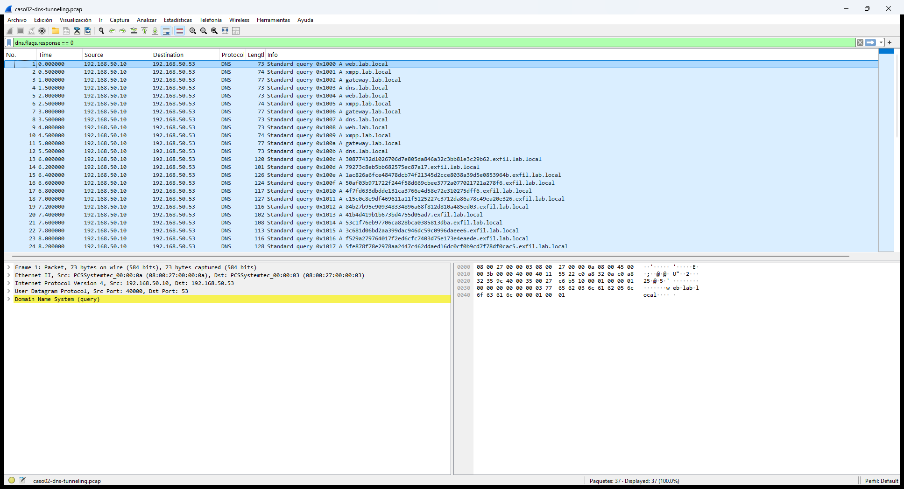
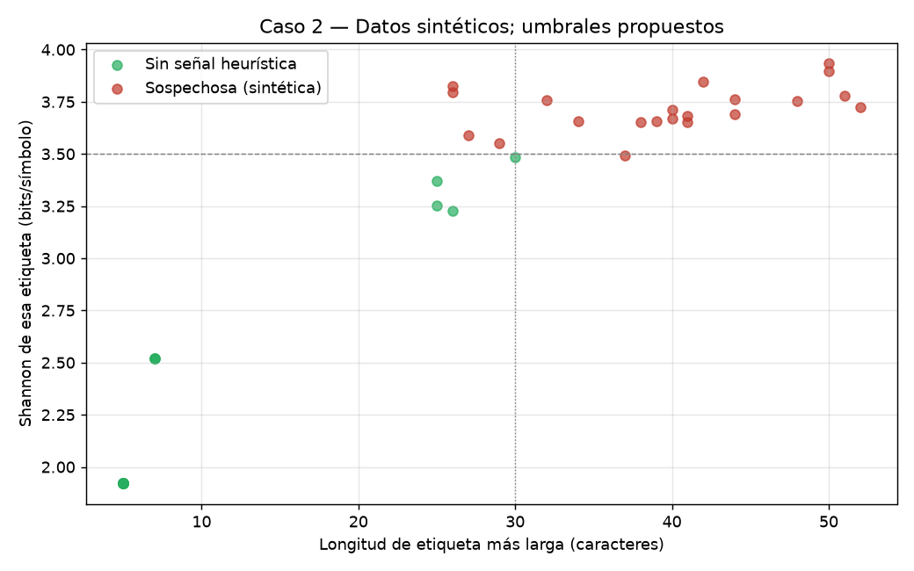

# Ficha PROVISIONAL — CASO-02: Heurística de etiquetas DNS

Nueve campos y preguntas propuestos; no transcripción de la guía original.

1. **ID:** CASO-02.
2. **Título:** Longitud y entropía de la etiqueta DNS más larga.
3. **Fecha y analista:** 2026-11-18; revisión del laboratorio autorizado.
4. **Categoría:** Detección exploratoria de posible canal DNS; datos sintéticos.
5. **Descripción:** el PCAP contiene 37 consultas: 12 nombres legibles y 25
   nombres con etiquetas hex aleatorias bajo `exfil.lab.local`, desde `.10` a
   `.53`. No contienen datos robados ni demuestran exfiltración.
6. **Severidad:** Alta potencial para exfiltración real; aquí sin impacto comprobado.
7. **Evidencias:** `evidencia/casos/caso02-dns-tunneling.pcap`,
   `caso02-analisis.txt`, `caso02-dns-entropy.png` (sintéticos/derivados);
   `caso02-dnsmasq-log.txt` (fragmento real independiente); `caso02-regla-dns.nft`
   (nota, sin reglas ejecutables).
8. **Observables:** etiquetas sintéticas hex de 25–52 caracteres efectivamente
   generados; H=3.229–3.933 bits/símbolo. Las 12 consultas legibles tienen
   etiqueta máxima 5–7 y H=1.922–2.522. Máximo del patrón hex: 5 consultas/1s.
9. **Estado:** Heurística sobre muestra artificial; túnel, correlación real y
   exfiltración no confirmados.

## Indicadores y análisis

Ejecutar offline `scripts/gen_caso02_dns_tunnel.py` y `scripts/analizar_caso02.py`.
Filtro: `dns.flags.response == 0 && dns.qry.name`.
Se normaliza qname a minúsculas y sin punto final; se toma la primera etiqueta
más larga si hay empate. Longitud y Shannon se calculan sobre **esa etiqueta**,
no sobre qname completo. Para hex H no puede superar 4 bits/símbolo.
La agrupación usa origen y últimas tres etiquetas; no equivale a 2LD/eTLD+1.

La propuesta `longitud > 30 OR H > 3.5` marca **21/25** nombres artificiales,
y 0/12 legibles: no separa perfectamente las poblaciones. Los cuatro restantes
no prueban benignidad. Se requieren muestras reales y evaluación de falsos positivos.

**Log real separado:** conserva una sola consulta demostrativa larga desde
`192.168.50.53` a las 20:08:41; etiqueta 52, H=3.724. El nombre coincide con uno
del guion, pero el origen del PCAP es `.10`; no hay correspondencia de
transacciones/tiempos que vincule la tanda de 25 consultas a ese log.
El fragmento registra REFUSED y ausencia de upstream: no confirma un canal de
exfiltración, ni se puede afirmar que dnsmasq recibió toda la tanda sintética.

## Controles propuestos

La detección implementada está en Python. Se retiró `dns.query; byte_test`
porque el buffer de nombre normalizado de un IDS no conserva los octetos de
longitud del wire format DNS. `caso02-regla-dns.nft` no contiene pseudofirmas
activas ni firewall genérico; no hay sintaxis nft ejecutable que validar.

Una eventual ACL debe revisarse en resolver `.53`/firewall local, contemplando
DNS UDP y TCP. El forward del gateway no filtra tráfico entre peers de la misma
subred. No aplicar bloqueos automáticos por longitud/entropía sin validación.

## Preguntas PROPUESTAS (no originales de la guía)

- **¿Qué mide H?** Diversidad de símbolos de la etiqueta elegida, no intención.
- **¿Qué confirma el log?** Una consulta demostrativa real desde `.53`, no la
  ejecución del escenario sintético ni exfiltración.
- **¿Puede reutilizarse el umbral?** Como señal exploratoria, pendiente calibración.

## Trazabilidad y evidencia visual

Versiones anteriores en `evidencia/casos/revision-anterior/`; log histórico
preservado. Hashes finales en el manifiesto y bloque anexado a `evidencia.log`.
`caso02-wireshark.png` permanece como histórico; la captura vigente es la siguiente.

