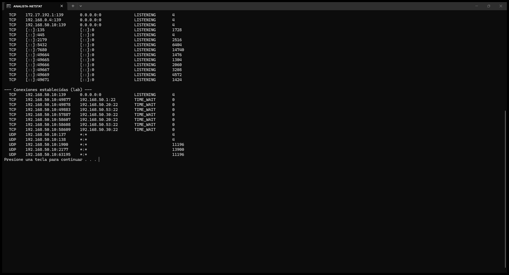
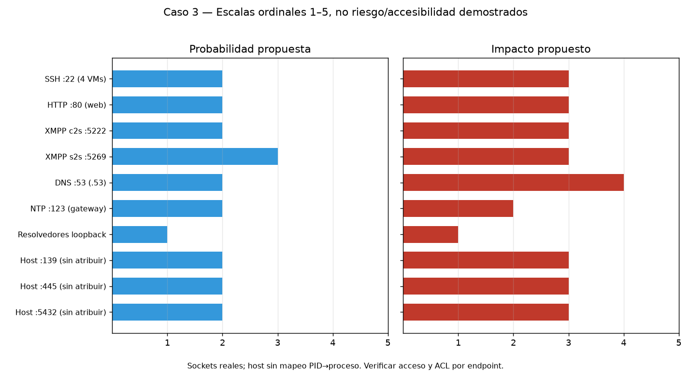

# Ficha PROVISIONAL — CASO-03: Sockets en escucha

Nueve campos y preguntas propuestos; no transcripción de la guía original.

1. **ID:** CASO-03.
2. **Título:** Inventario observado; accesibilidad efectiva pendiente.
3. **Fecha y analista:** 2026-11-18; revisión del laboratorio autorizado.
4. **Categoría:** Endurecimiento / inventario; no intrusión demostrada.
5. **Descripción:** `ss -tulpn` histórico observa SSH en las cuatro VMs, HTTP en
   web, DNS en `.53`, NTP en gateway y XMPP 5222/5269 en `.30`. Netstat del host
   observa adicionalmente escuchas 139/445/5432. Escuchar no prueba acceso desde
   otro equipo ni ausencia de controles del endpoint.
6. **Severidad:** Media provisional, dependiente de necesidad y acceso real;
   la gráfica usa valoraciones cualitativas propuestas, no riesgo medido.
7. **Evidencias reales:** `evidencia/casos/caso03-ss-tulpn.txt`,
   `caso03-netstat-host.txt`, `caso03-auth-events.txt`, `caso03-netstat-consola.png`.
   Derivada: `caso03-riesgo.png`, regenerada sin etiquetas solapadas.
8. **Observables:** sockets y PID numéricos de la tabla siguiente. Fragmentos
   auth: 8 `Accepted password`, 0 `Failed password` en el texto preservado.
   Cero coincidencias aquí no demuestra ausencia global de fallos de autenticación.
9. **Estado:** Inventario observado; atribución de procesos del host, necesidad
   y accesibilidad no verificadas. No hay evidencia de intrusión en estos datos.

## Inventario y límites

| Equipo | Escucha observada | Atribución / alcance |
|---|---|---|
| gateway `.1` | TCP22 IPv4/IPv6; UDP123 IPv4 | sshd / chronyd según ss |
| web `.20` | TCP22 y 80 IPv4/IPv6 | sshd / nginx según ss |
| dns `.53` | TCP/UDP53 en `.53`; TCP22 IPv4/IPv6 | dnsmasq / sshd según ss |
| xmpp `.30` | TCP22, 5222, 5269 IPv4/IPv6 | sshd / lua5.4 (contexto Prosody) |
| VMs | 53 loopback, 323 loopback | servicios locales; no acceso remoto probado |
| host | TCP139 en `.50.10`, `.0.4`, `172.17.192.1` | PID4 observado; proceso no atribuido |
| host | TCP445 en `0.0.0.0` y `[::]` | PID4 observado; proceso no atribuido |
| host | TCP5432 en `0.0.0.0` y `[::]` | PID6404 observado; proceso no atribuido |

No identificar SMB/PostgreSQL ni un producto concreto solo por puerto. Los PID
constan en netstat, pero falta correlación PID→proceso/servicio en el instante
original; una consulta posterior al PID puede corresponder a otro proceso.
El script `scripts/analizar_caso03.py` lee los fragmentos, extrae esos sockets y
presenta una fila por servicio en la gráfica para evitar etiquetas superpuestas.

El gateway `.1` **no filtra el tráfico directo entre VMs/host de la misma subred**.
Su firewall no mitiga automáticamente SSH o XMPP en otras VMs. Una red sin
salida a Internet tampoco elimina acceso lateral. No se verificaron aquí las
ACL locales ni acceso activo; no confundir este inventario con un escaneo real.

## Controles propuestos (no aplicados)

- Evaluar necesidad de XMPP s2s y restringirlo **en `.30`**, no mediante input/forward
  del gateway. No se cambia Prosody ni se reinicia ningún servicio.
- Revisar SSH y reglas locales de cada VM por orígenes autorizados, incluyendo IPv6.
- Evaluar TLS HTTP según datos transportados; no inferir una vulnerabilidad solo
  de ver puerto80 sin inspección adicional.
- Auditar PID/proceso y necesidad de 139/445/5432 en el host; validar alcance con
  pruebas benignas autorizadas antes de cerrar servicios.
- El bind de DNS a una IP privada no prueba que no sea resolver abierto: revisar
  ACL y comportamiento de recursión por origen; ver límites del caso6.

## Preguntas PROPUESTAS (no originales de la guía)

- **¿Escucha implica exposición remota?** No; intervienen ruta, firewall y ACL.
- **¿Dónde filtrar peers?** En endpoints o un dispositivo realmente en su ruta.
- **¿Qué significa no ver Failed password?** Solo que no aparece en estos
  fragmentos; faltan cobertura temporal y registros completos para inferencias globales.

## Trazabilidad y evidencia visual

Logs y pantallazo de consola preservados; versiones anteriores en
`evidencia/casos/revision-anterior/`. Gráfica corregida incluida en el manifiesto
de cierre; hashes anexados a `evidencia.log`, sin borrar su historial.
El pantallazo es del inventario en el instante original, no una nueva medición.
Su rótulo heredado «Conexiones establecidas» no filtra por estado: también
incluye LISTENING, TIME_WAIT y UDP; deben interpretarse las filas, no ese rótulo.

