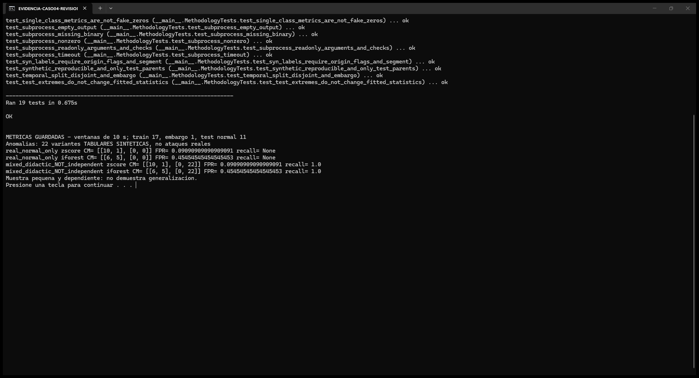
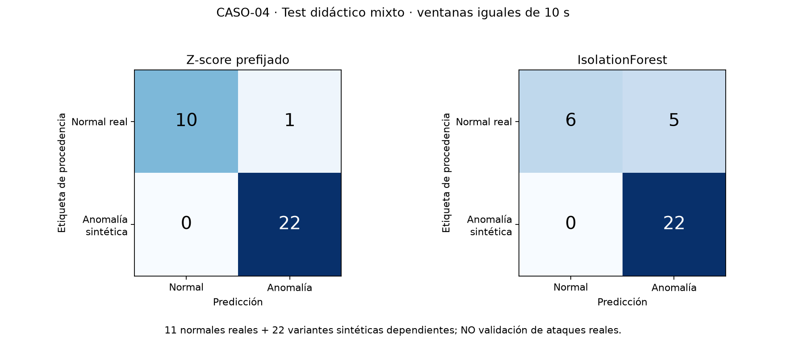
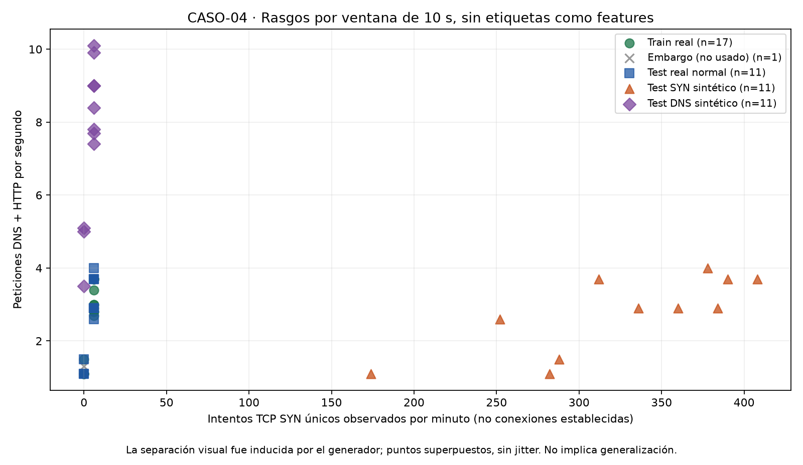

# Ficha de hallazgo — CASO-04: Anomalías ML, revisión metodológica

> Taller educativo aislado y exclusivamente offline. No se ejecutan ataques ni
> se valida un detector para producción. Los resultados anteriores de 28 ventanas
> quedan **obsoletos**: tenían ventanas de distinta duración, etiquetas por PCAP
> completo y evaluación sobre los mismos normales usados para entrenar.

## Los 9 campos

1. **ID:** `CASO-04`.
2. **Título:** evaluación temporal de IsolationForest y z-score con normales
   observados y anomalías tabulares sintéticas, distinguidos explícitamente.
3. **Fecha y analista:** revisión del taller 2026-11-18 (host Windows); las
   ejecuciones quedan fechadas en UTC 2026-11-19 en `caso04-manifiesto.json`.
4. **Categoría / técnica:** evaluación metodológica de detección no supervisada.
5. **Hallazgo:** el baseline permite 29 ventanas completas de 10 s: 17 para
   entrenamiento, una de embargo y 11 para test normal. Se construyeron 22
   variantes sintéticas de test (11 SYN, 11 DNS), sin usar los PCAP de casos 1/2.
   Ambos detectores reconocieron las 22 variantes; en normales reales z-score
   generó 1 falso positivo e IsolationForest 5. Esto **no prueba** capacidad de
   generalización ni superioridad de un algoritmo.
6. **Severidad:** media, **metodológica**, no un incidente de seguridad confirmado.
7. **Evidencia:** script `scripts/caso04_ml.py` y artefactos `caso04-*` en
   `evidencia/casos/`, inventariados abajo. La captura antigua de consola no es
   evidencia vigente.
8. **Observables:** marcadores de atribución del generador: SYN inicial con
   origen `192.168.50.100` y nombre DNS con sufijo `.exfil.lab.local`, dentro del
   segmento declarado. No son IoC de un ataque real; no se incluyen IP, sufijo,
   etiqueta ni procedencia entre las features del modelo.
9. **Estado:** pipeline ejecutado, 19 pruebas unitarias aprobadas, reproducibilidad
   verificada. **Muestra pequeña, un único baseline y ninguna anomalía real de
   test; evaluación exploratoria, sin comparación fuerte.**

## Datos, ventanas y trazabilidad

- Único PCAP leído: `evidencia/baseline-normal.pcapng`, sin modificarlo.
- SHA-256: `301ea4766c642919734e3649b1de4c049bb4bebeb8ff9b4125306322b3b076ff`.
- Duración observada: 296.6701611 s; 1.639 frames. Se decodificaron 1.418 paquetes
  TCP/UDP IPv4/IPv6; se excluyeron 221 frames de otros protocolos o sin cabecera
  de transporte decodificada. No se comparan directamente estas features con
  las del análisis antiguo.
- Todas las ventanas son **10 s**, intervalos semiabiertos `[inicio, fin)` desde
  el origen temporal del PCAP. Se conservan las vacías con features cero.
  Se descarta la cola parcial `[290, 296.6701611]`: 6.6701611 s y 24 paquetes
  TCP/UDP. Las 29 ventanas completas contienen 1.394 paquetes TCP/UDP.
- Dataset: **51 filas** = 29 ventanas reales + 22 variantes sintéticas. De ellas,
  17 son train, una embargo y 33 test. No son 51 observaciones independientes.
- `caso04-dataset.csv` incluye `sample_id`, `source_file`, `source_sha256`,
  `packet_table`, `packet_table_sha256`, `baseline_file`, `baseline_sha256`,
  `window_id`, inicio/fin/duración, `data_kind`, `split`, `parent_window_id`,
  `scenario_id`, `segments_json`, `label`, `label_name`, `label_basis`,
  `normal_packets`, `anomaly_packets` y las 30 features.
- El CSV de paquetes baseline conserva frame original, tiempo, fichero, hash,
  ventana y etiqueta normal asumida. El CSV sintético conserva, por registro,
  escenario, ventana padre, etiqueta y `origin_kind`: `real_background` o
  `synthetic_injected`. El fondo conserva su frame/hash original; lo inyectado
  conserva receta, hash del script y referencia a semilla/escenario/índice.

### Etiquetas: segmentos y marcadores, no nombre de PCAP

1. **Normal real:** supuesto operativo del segmento baseline; no significa que
   se haya demostrado ausencia de actividad maliciosa.
2. **SYN sintético:** paquete TCP con `src=192.168.50.100`, `SYN=1`, `ACK=0`,
   dentro del segmento SYN declarado. Un SYN de otro origen o un SYN-ACK no
   recibe esa etiqueta.
3. **DNS sintético:** consulta **o respuesta** DNS cuyo primer `dns.qry.name`
   termina en `.exfil.lab.local` (sin distinguir mayúsculas y eliminando el
   punto final), dentro del segmento DNS declarado. No basta contener ese
   texto como parte de otro dominio.
4. Los paquetes de fondo sin marcador permanecen normales, incluso dentro del
   fichero/escenario sintético. Una ventana es anómala si contiene al menos un
   paquete atribuido al segmento; esto es atribución educativa, no un umbral que
   demuestre un flood. Se exportan por separado los recuentos normal/anómalo.
5. Un marcador fuera de su segmento provoca rechazo, no etiquetado silencioso.

Los segmentos están en `caso04-segmentos.csv`. Cada variante conserva el fondo
completo de una ventana **de test**, e inserta registros entre `inicio+2` e
`inicio+8` s. Con `random.Random(42)`, el número de consultas o SYN se obtiene
como `max(12, paquetes_fondo // 2) + randrange(12, 37)`. El DNS lleva tokens
hexadecimales de 40 caracteres y respuesta a las consultas de índice par.
**Son registros de una tabla, no paquetes transmitidos ni un PCAP fabricado.**
Los tiempos sintéticos son coordenadas heredadas del baseline, no fecha de un
ataque observado. Ningún PCAP de casos 1/2 se leyó, copió o alteró.

## Separación temporal y prevención de leakage

| Partición real | Ventanas | Intervalo | Uso |
|---|---|---|---|
| Train | 0–16 (17) | `[0,170)` s | Único ajuste de estadísticas y modelo |
| Embargo | 17 (1) | `[170,180)` s | Ni entrenamiento ni evaluación |
| Test normal | 18–28 (11) | `[180,290)` s | Falsos positivos sobre normales posteriores |
| Test sintético | 11 SYN + 11 DNS | Padres exclusivamente 18–28 | Sensibilidad a perturbaciones artificiales |

La partición se fija **antes** de construir variantes y antes de cualquier
`fit`. Media, desviación, features constantes y árboles se estiman solo con
train real normal. La predicción se ejecuta únicamente sobre test; no se
exportan métricas sobre train como si fueran evaluación. Una lista explícita
`FEATURES` excluye etiquetas, identidad, timestamps, origen y partición.
Se rechazan padres compartidos train/test o la ausencia de embargo; la
validación adicional confirmó cero frames compartidos entre train y test.

El embargo no elimina toda autocorrelación: puede haber conversaciones
persistentes en distintas ventanas y todas proceden de una única captura.
Las dos variantes y su normal padre **comparten fondo dentro de test**; esa
dependencia se declara y no se usa para inflar el tamaño de muestra efectivo.

## Features y convenciones (30 columnas)

| Grupo | Features | Definición / cautela |
|---|---|---|
| Volumen y flujos | `n_pkts`, `n_bytes`, `n_flows`, `n_dst_ports`, `bytes_per_flow` | Flujos bidireccionales por protocolo y par canónico de IP:puerto; bytes de frame. Puertos destino incluyen ambos sentidos. |
| Duración | `flow_duration_mean_s`, `flow_duration_max_s` | Por flujo: último menos primer timestamp **dentro de la ventana**; un único paquete da 0. No es duración total de sesión. |
| Tasas | `packets_per_s`, `bytes_per_s`, `flows_per_min` | Denominador común de 10 s; flujos/min son conversaciones observadas, no nuevas conexiones. |
| Flags | `n_syn`, `n_syn_ack`, `n_ack`, `n_reset`, `n_fin`, `syn_ratio`, `reset_ratio` | `n_syn` cuenta SYN sin ACK; los ratios dividen entre paquetes. |
| Intentos TCP | `n_tcp_syn_attempts`, `connections_per_min` | Flujos distintos con SYN inicial; retransmisiones del mismo flujo se deduplican dentro de la ventana. `connections_per_min = intentos × 6`, **no conexiones establecidas**. |
| Petición/respuesta | `request_count`, `response_count`, `request_response_ratio`, `requests_without_response`, `requests_per_s`, `responses_per_s` | Solo DNS y HTTP decodificados; ratio `Q/max(R,1)`. `requests_without_response` es indicador 0/1 de Q>0 y R=0 en la ventana, no transacciones emparejadas. |
| DNS/HTTP | `dns_queries`, `dns_responses`, `dns_query_length_mean`, `http_requests`, `http_responses` | Longitud del nombre consultado, no coincidencia con el sufijo de etiquetado. No se descifra TLS. |

Se usa la primera ocurrencia de cada campo de tshark. Capturas incompletas,
fragmentos, tráfico cifrado o límites de ventana pueden sesgar duración y ratios;
no deben interpretarse como contabilidad perfecta de sesiones/transacciones.

## Detectores prefijados y resultados obtenidos

- **Z-score:** media y desviación poblacional (`ddof=0`) de train. Alerta si
  alguna feature no constante tiene `|z|>3`. Para features constantes en train,
  alerta ante cambio absoluto `>1e-9`; se evita dividir por epsilon. Esta
  convención puede ser sensible a valores nuevos legítimos y no fue calibrada
  con test. Los parámetros se exportan para poder auditarla.
- **IsolationForest:** 200 árboles, `contamination="auto"`, semilla 42,
  `n_jobs=1`, umbral nativo `offset=-0.5`. Sin ajuste sobre test ni selección de
  algoritmo basada en el resultado. No requiere escalado para este experimento.

### Separación real / sintético (resultado principal)

| Subconjunto test | n | Z-score | IsolationForest |
|---|---:|---|---|
| Normales reales | 11 | TN=10, FP=1; FPR=0.091 | TN=6, FP=5; FPR=0.455 |
| SYN sintético | 11 | TP=11, FN=0; recall=1.000 | TP=11, FN=0; recall=1.000 |
| DNS sintético | 11 | TP=11, FN=0; recall=1.000 | TP=11, FN=0; recall=1.000 |

Falso positivo z-score: ventana 23. IsolationForest: ventanas 20, 22, 23, 24 y
26. El subconjunto real carece de positivos: recall no estimable. Los
subconjuntos sintéticos carecen de negativos: FPR no estimable. Precision/F1 no
se informan por clase única (`null` en JSON, `N/A` en texto), no se rellenan con
ceros ni se presentan como validación discriminativa completa.

### Mezcla didáctica, dependiente (solo diagnóstico)

33 filas: 11 normales reales + 22 anomalías sintéticas. Filas de la matriz =
etiqueta, columnas = predicción, orden `[normal, anomalía]`.

| Detector | Matriz | Accuracy | Precision | Recall | F1 |
|---|---|---:|---:|---:|---:|
| Z-score | `[[10,1],[0,22]]` | 0.970 | 0.957 | 1.000 | 0.978 |
| IsolationForest | `[[6,5],[0,22]]` | 0.848 | 0.815 | 1.000 | 0.898 |

La proporción de anomalías fue elegida artificialmente; precision, F1 y accuracy
no representan prevalencia ni rendimiento operativo. Las perturbaciones fueron
construidas para alterar las features y son fáciles para ambos detectores.
**No afirmar que z-score es más robusto en general, ni que el ML detecta ataques
reales con recall 1.** No hay suficientes capturas, clases reales ni escenarios
independientes para esas conclusiones. Tampoco se justifican intervalos de
confianza tratando las variantes dependientes como ensayos independientes.

## Reproducción y pruebas ejecutadas

Desde cualquier directorio, sin instalar dependencias ni activar red:

```powershell
python "C:/Users/yatoG/Documents/Qoder/2026-11-18/70141794/lab/scripts/caso04_ml.py" --self-test
python "C:/Users/yatoG/Documents/Qoder/2026-11-18/70141794/lab/scripts/caso04_ml.py"
```

Se requiere tshark local (ruta por defecto de Wireshark; alternativa
`--tshark RUTA_LOCAL`), Python y las bibliotecas ya instaladas. Versiones de la
ejecución: Python 3.14.7, pandas 3.1.1, NumPy 2.5.5, scikit-learn 1.9.1,
Matplotlib 3.11.2; también registradas en el manifiesto.

- **19 pruebas unitarias: OK.** Cubren split temporal/embargo, muestra
  insuficiente, train normal, padres disjuntos, fit limitado a train/features,
  invariancia de estadísticas ante extremos de test, etiquetas SYN/DNS y fondo,
  límites de segmentos, ventanas vacías/límites/cola, duración bidireccional,
  deduplicación de SYN, ratios sin denominador, reproducibilidad sintética,
  métricas con clase única y parsing de flags booleanos de distintas versiones.
- Subprocess: pruebas de salida no cero, timeout, binario ausente, salida vacía,
  lectura `-n -r`, `check=True`, `shell=False` y extracción malformada. El primer
  intento de pipeline rechazó flags DNS `True/False`; se corrigió su parsing y
  se añadió una prueba de regresión antes de la ejecución satisfactoria.
- El pipeline ejecuta las pruebas antes de escribir, respalda la versión
  anterior y genera `caso04-pruebas.txt`. `--self-test` solo imprime resultados.
- Verificación adicional: **dos ejecuciones consecutivas con hashes idénticos**
  de tablas, parámetros, predicciones, métricas JSON y ambas gráficas. Baseline
  y screenshot antiguo conservaron su hash. El informe de esta comprobación
  puntual es `caso04-reproducibilidad.json`; no es una comprobación automática
  futura ni forma parte de los hashes internos del manifiesto. El tiempo de
  tests y las rutas/fechas de nuevos backups pueden variar legítimamente.
- Ningún socket, captura en vivo ni comando de ataque: únicamente tshark
  `-n -r` offline, con timeout y fallo cerrado. No se usa `evidencia.log`.

## Artefactos vigentes y preservación

En `evidencia/casos/`:

- `caso04-dataset.csv`: todas las particiones, procedencia, etiquetas y features.
- `caso04-baseline-paquetes.csv`, `caso04-sinteticos-paquetes.csv`,
  `caso04-segmentos.csv`: trazabilidad de paquetes/registros y reglas temporales.
- `caso04-predicciones.csv`: solo test, scores y predicciones de ambos métodos.
- `caso04-modelo-parametros.json`: features, IDs train, estadísticas y parámetros.
- `caso04-metricas.txt`, `caso04-metricas.json`: resultados separados y advertencias.
- `caso04-matriz-confusion.png`: matrices de ambos métodos, rotuladas como test
  mixto real/sintético. `caso04-scatter.png`: train, embargo, normal test y
  escenarios sintéticos diferenciados; la separación visual no prueba validez.
- `caso04-manifiesto.json`: SHA-256 de entrada/script/salidas, comando de lectura,
  versiones, exclusiones, particiones y backup anterior.
- `caso04-pruebas.txt`, `caso04-reproducibilidad.json`: pruebas y verificación.
- `caso04-pantallazos-obsoletos.txt`: estado y hash de screenshots preservados.

**Backup inicial, anterior a cualquier regeneración:**
`evidencia/casos/revision-ml-anterior/20261119T014046Z-40a56cb8/`.
Contiene los cinco artefactos antiguos, script y ficha anteriores, con hashes.
Cada regeneración añade otro subdirectorio único, sin sobrescribir backups.

**Pantallazo vigente:** `caso04-consola-revisada.png` muestra la nueva ejecución
de las 19 pruebas y las métricas guardadas. `caso04-consola.png` permanece intacto
como histórico obsoleto. Las gráficas se regeneraron con los datos nuevos.







Los nueve campos son provisionales hasta contrastarlos con el apartado 7 literal.

## Controles y preguntas propuestas

No activar bloqueos ni exigir coincidencia entre detectores basándose en este
experimento. Siguiente validación propuesta: nuevas sesiones normales, anomalías
reales controladas del taller, separación por captura/tiempo, más regímenes de
tráfico y un conjunto de validación distinto del test para calibrar umbrales.

**La guía original no está disponible. Las siguientes preguntas son propuestas
para el taller, no transcripciones ni respuestas oficiales de aquella guía:**

1. **¿Qué falseaban las ventanas distintas?** El volumen dependía también de
   15/5/3 s de observación; ahora todos los recuentos usan 10 s y hay tasas.
2. **¿Por qué no etiquetar todo un PCAP como ataque?** Incluye fondo normal.
   Aquí cada registro conserva su atribución; solo las ventanas con marcadores
   dentro de segmentos reciben label anómala.
3. **¿Qué leakage se eliminó?** La reutilización de normales de entrenamiento
   como test y el cálculo de estadísticas con test; persiste dependencia de
   una sola captura y entre variantes de un mismo padre, que se declara.
4. **¿Qué significa recall 1.000?** Solo que se detectaron las 22 perturbaciones
   sintéticas de esta receta, no ataques reales ni familias desconocidas.
5. **¿Qué falta para comparar algoritmos?** Más capturas independientes y clases
   reales, prevalencia representativa, validación separada y análisis de falsas
   alarmas; esta muestra no permite recomendar un ganador.
