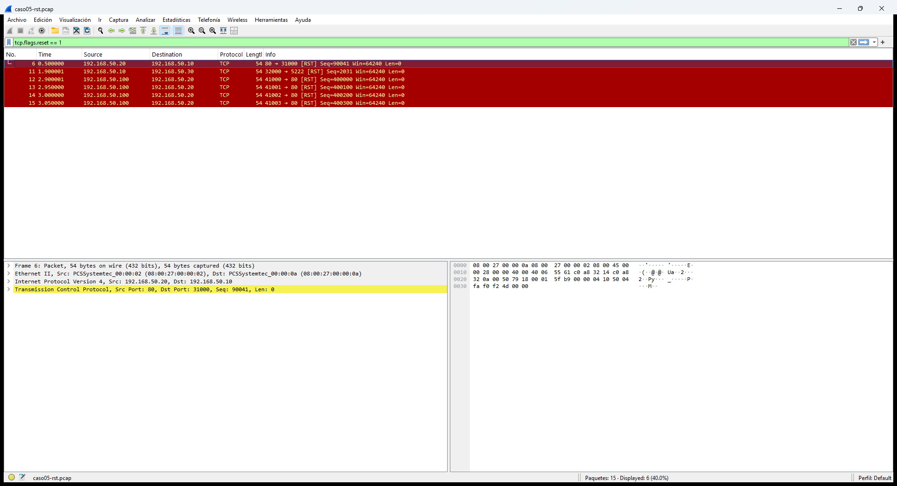

# Ficha PROVISIONAL — CASO-05: RST y contexto de flujo

Nueve campos y preguntas propuestos; no transcripción de la guía original.

1. **ID:** CASO-05.
2. **Título:** RST en sesiones modeladas y cuatro RST fuera de flujo.
3. **Fecha y analista:** 2026-11-18; revisión del laboratorio autorizado.
4. **Categoría:** Análisis TCP, no inyección efectiva demostrada.
5. **Descripción:** el PCAP sintético contiene 6 RST: uno del servidor web en
   `.20:80 → .10:31000`, uno del cliente `.10:32000 → .30:5222`, y cuatro desde
   `.100:41000–41003 → .20:80`. Estos últimos no comparten la 4-tupla de ninguna
   sesión anterior: están fuera de flujo, no son resets efectivos de terceros.
6. **Severidad:** Media potencial para una interrupción TCP real; ninguna sesión
   real fue interrumpida ni se probó falsificación en este ejercicio offline.
7. **Evidencias:** `evidencia/casos/caso05-rst.pcap`, `caso05-analisis.txt`
   (sintéticos/derivados); `caso05-logs-correlacion.txt` (fragmentos reales
   históricos, nombre heredado no implica correlación); `caso05-wireshark.png`
   (screenshot histórico).
8. **Observables:** 6 RST, 2 con handshake previo observado y 4 sin él. En los
   cuatro de `.100`, seq_raw=400000, 400100, 400200, 400300; ack_raw=0,
   flag ACK ausente. Las secuencias relativas mostradas por Wireshark no son raw.
9. **Estado:** Casos de análisis sintéticos; no ataque, entrega efectiva ni
   falsificación confirmados.

## Indicadores y análisis

Ejecutar offline `scripts/gen_caso05_rst.py` y `scripts/analizar_caso05.py`.
Filtro de interés: `tcp.flags.reset == 1`. El análisis conserva stream,
4-tupla, tiempo y `tcp.seq_raw`/`tcp.ack_raw`; busca handshake previo correlacionado.

Un **RST sin ACK puede ser legítimo**; si el flag ACK no está activo, el campo
ack no tiene significado de reconocimiento. `ack=0` no prueba suplantación ni
malicia. Los dos RST del guion en sesiones establecidas tampoco tienen flag ACK.
La coherencia de tupla/secuencia ayuda al análisis pero no demuestra aceptación
por una pila TCP real, identidad del emisor o impacto en aplicación.

Los logs reales de nginx/prosody contienen GET200 y aperturas/cierres históricos.
No tienen correlación temporal/de sesión con paquetes escritos a archivo por el
generador. La ausencia de una entrada asociada no demuestra tráfico inyectado:
no hubo tráfico real que pudiera producirla, y los logs son fragmentos.

## Controles propuestos

Retirada la pseudofirma que equiparaba `ack:0` a RST forjado. Detectar ráfagas
solo como señal, añadiendo tupla, estado, secuencia, cobertura de captura y
contexto de aplicación antes de atribuir intención. Un firewall stateful y la
validación TCP corresponden al endpoint/ruta real; el gateway no inspecciona
peers de la misma subred. No se aplica bloqueo de `.100` ni reglas generales.

## Preguntas PROPUESTAS (no originales de la guía)

- **¿Son una inyección los RST de `.100`?** No en una sesión observada: usan
  otras tuplas. No se demostró falsificación o terminación de conexiones.
- **¿Basta ack=0 para alertar?** No; RST sin flag ACK es legal en varios contextos.
- **¿Qué haría falta para una correlación real?** Captura y logs de la misma
  ejecución, tiempos y sesiones identificables, más evidencia del endpoint.

## Trazabilidad y evidencia visual

Versiones anteriores en `evidencia/casos/revision-anterior/`; logs intactos.
`caso05-wireshark.png` se conserva como histórico. El pantallazo vigente usa
`tcp.relative_sequence_numbers:FALSE` solo para esa ventana: muestra las
secuencias raw 400000–400300 sin modificar preferencias globales.
Hashes finales en el manifiesto y bloque anexado a `evidencia.log`.

