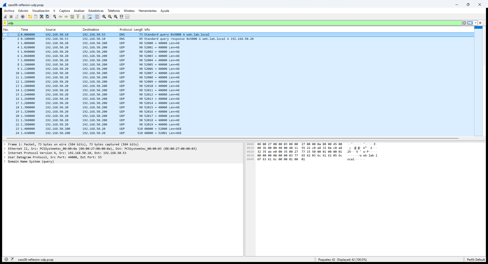
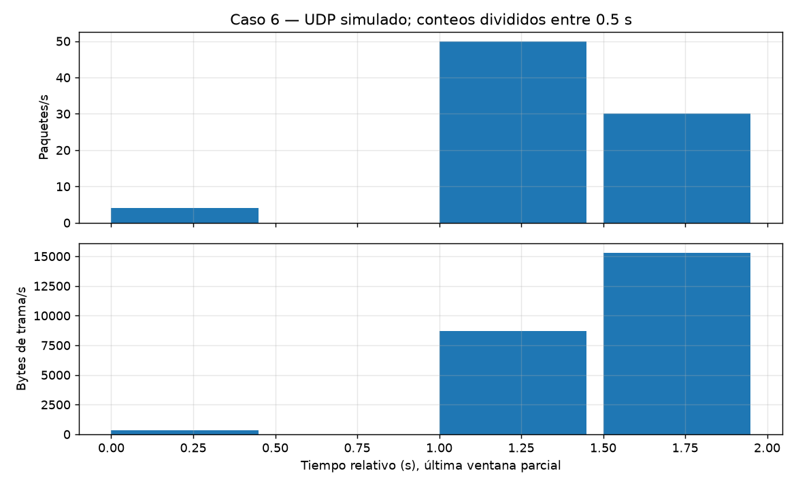

# Ficha PROVISIONAL — CASO-06: Asimetría UDP simulada

Nueve campos y preguntas propuestos; no transcripción de la guía original.

1. **ID:** CASO-06.
2. **Título:** Modelo de reflexión con datagramas genéricos, no amplificador NTP real.
3. **Fecha y analista:** 2026-11-18; revisión del laboratorio autorizado.
4. **Categoría:** Estudio UDP/DoS reflectivo; simulación offline.
5. **Descripción:** 20 pares artificiales entre `.20:52000–52019` y `.200:40000`,
   payloads 48/468 B. El puerto40000 es didáctico y no implementa NTP. El guion
   asigna MAC de `.100` a las solicitudes con IP `.20`; esa suplantación es
   parte del modelo, no una observación de red real. Además, un par DNS normal
   válido consulta/responde `web.lab.local` entre `.10` y `.53`.
6. **Severidad:** Alta potencial para reflexión real; no se midieron pérdida,
   saturación, amplificación por servicio real ni indisponibilidad.
7. **Evidencias:** `evidencia/casos/caso06-reflexion-udp.pcap`,
   `caso06-analisis.txt`, `caso06-udp-rate.png` (sintéticos/derivados);
   `caso06-openresolver.txt` (histórico **incompleto**, intacto);
   `caso06-openresolver-revision.txt` (nueva consulta benigna real con stdout,
   stderr, comando, origen y hora); `caso06-wireshark.png` (histórico).
8. **Observables:** 42 datagramas: 2 DNS y 40 del modelo. Pares UDP correlacionados
   por dirección/puerto cliente; excluyendo DNS, 1800 B de tramas de solicitud y
   10200 B de respuesta: cociente 5.667x. Payload: 960→9360 B, 9.750x.
9. **Estado:** Asimetría sintética calculada; reflector y ataque reales no probados.

## Correcciones y análisis reproducible

Ejecutar offline `scripts/gen_caso06_udp.py` y `scripts/analizar_caso06.py`.
DNS incluye QTYPE=A/QCLASS=IN y respuesta QR=1, NOERROR, una respuesta A con
IP `.20`. Se retiraron la pregunta DNS truncada y los 468 ceros presentados
incorrectamente como NTP. Tshark no marca DNS malformado ni NTP en el nuevo PCAP.

Las tramas calculadas no incluyen FCS/padding Ethernet; no son bytes físicos
exactos del enlace. El cociente de tamaños diseñado no mide capacidad real de
amplificación de ningún servicio. Una diferencia MAC/IP sola tampoco prueba
spoofing fuera del modelo sin conocer topología y punto de captura.

Ventanas nominales de **0.5 s**: tasas = conteo/0.5. En [1,1.5) hay 25 datagramas,
4350 B: **50 paquetes/s y 8700 B/s**. En [1.5,2) hay 15 y 7650 B:
**30 paquetes/s y 15300 B/s**; esta última está parcialmente observada, pues
la captura termina a 1.78 s. Los valores son tasas normalizadas al ancho nominal.

## Evidencia DNS real, separada

El archivo `caso06-openresolver.txt` perdió stderr/REFUSED: no certifica el
resultado esperado del título. Se conserva sin completarlo retrospectivamente.
El bind privado `.53` tampoco demuestra ACL, recursión segura ni imposibilidad
de funcionar como resolver abierto para otros orígenes.

**Nueva prueba benigna:** SSH existente a `.53`,
`dig -b 192.168.50.53 @192.168.50.53 example.com A +time=2 +tries=1`,
2026-11-18 20:47:31 -05. Resultado **REFUSED**, EDE14 Not Ready, respuesta46 B,
stdout preservado, stderr vacío, exit0. El flag RA aparece en la respuesta;
no debe interpretarse como resolución exitosa. Solo prueba rechazo de ese
nombre/origen/instante, no ausencia universal de resolver abierto o reflectores.
No cambios en VM ni reinicio de servicios. El REFUSED histórico del caso2 es
otra evidencia, no reparación del archivo incompleto.

## Controles propuestos

Revisar ACL/recursión del resolver y permisos UDP por cliente en endpoints.
Anti-spoofing requiere controles en el acceso/ruta apropiados; filtrar solo
prefijos no detecta suplantación entre peers de una misma subred. El gateway no
ve necesariamente ese tráfico. Se retira la regla standalone `policy drop`;
no se modifica firewall ni se prueban reflectores o tráfico de ataque.

## Preguntas PROPUESTAS (no originales de la guía)

- **¿El cociente prueba amplificación NTP?** No: son payloads genéricos diseñados.
- **¿Qué prueba REFUSED?** Esa consulta acotada fue rechazada, nada universal.
- **¿Cómo comparar tasas?** Dividir por el ancho de ventana y declarar los límites.

## Trazabilidad y evidencia visual

Versiones anteriores en `evidencia/casos/revision-anterior/`; evidencia histórica
intacta. `caso06-wireshark.png` es obsoleto; el pantallazo nuevo muestra el
puerto40000 y DNS válido, sin presentar el modelo como NTP.
Hashes finales en el manifiesto y bloque anexado a `evidencia.log`.

