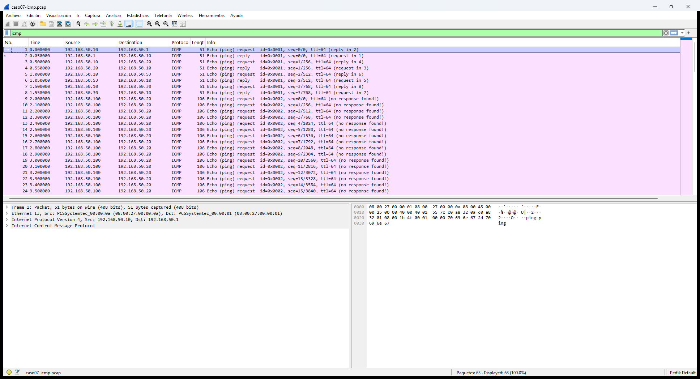
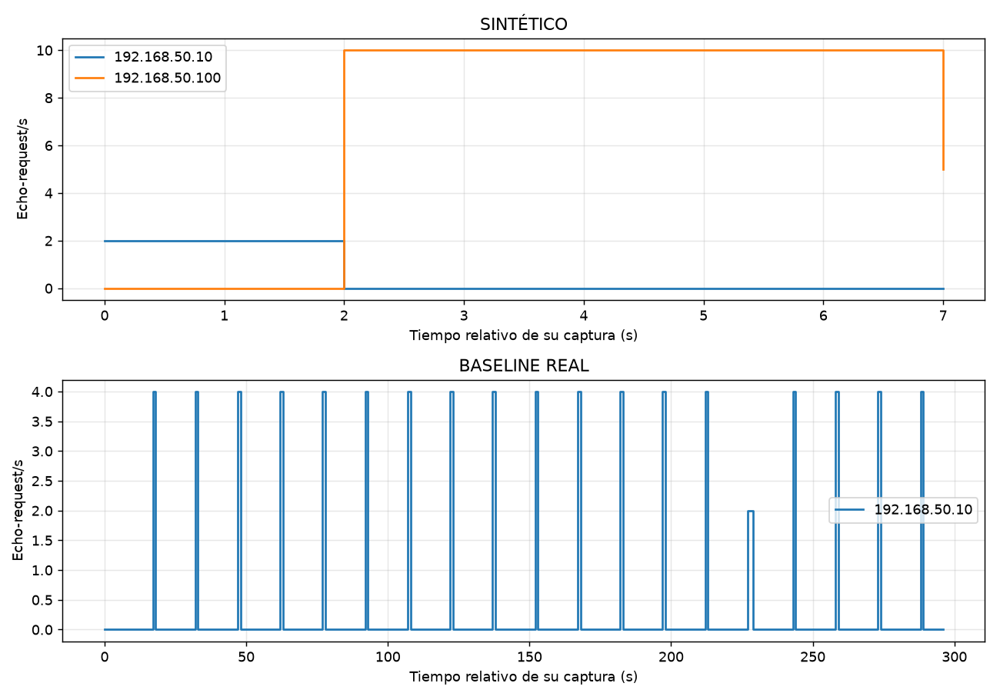

# Ficha PROVISIONAL — CASO-07: ICMP, tamaños y frecuencias

Nueve campos y preguntas propuestos; no transcripción de la guía original.

1. **ID:** CASO-07.
2. **Título:** Comparación de ICMP echo sintético frente a baseline real.
3. **Fecha y analista:** 2026-11-18; revisión del laboratorio autorizado.
4. **Categoría:** Señales exploratorias de frecuencia/tamaño ICMP, no exfiltración probada.
5. **Descripción:** 63 paquetes sintéticos: cuatro pares request/reply `.10`
   con VMs, 50 requests de `.100` a `.20` con payload64 B, y cinco requests
   artificiales grandes. No se generó tráfico de ataque en red.
6. **Severidad:** Media-Alta potencial para abuso real; no se midió degradación
   ni se demostró un canal encubierto o datos exfiltrados.
7. **Evidencias:** `evidencia/casos/caso07-icmp.pcap`, `caso07-analisis.txt`,
   `caso07-icmp-freq.png` (sintéticos/derivados); `evidencia/baseline-normal.pcapng`
   (real, leído); `caso07-regla-icmp.nft` (propuesta); `caso07-wireshark.png`
   (screenshot histórico).
8. **Observables:** payloads sintéticos 9/64/1289 B, tramas correspondientes
   51/106/1331 B. `.100` emite 55 requests, máximo10 por ventana1s; cinco tienen
   payload>200 B. No confundir tamaño de trama con datos ICMP.
9. **Estado:** Diferencias de tamaño/frecuencia observadas en simulación;
   exfiltración, túnel, daño y umbrales de ataque no confirmados.

## Indicadores y análisis

Ejecutar offline `scripts/gen_caso07_icmp.py` y `scripts/analizar_caso07.py`.
Se leen ambas capturas; filtro echo IPv4 tipos0/8 sin fragmentación. Se calcula
payload=`ip.len - ip.hdr_len - 8`, no `frame.len`. No se extrapola la fórmula a
otros tipos ICMP, fragmentos o IPv6. Las otras categorías ICMP quedan fuera.

**Baseline real:** duración296.670161 s; 152 echo (76 requests y 76 replies),
19 requests `.10` a cada VM. Payload32 B, trama74 B; para `.10 → .20`, media
19/296.670161=0.0640 requests/s y máximo1 por ventana1s. No es el ping sintético
de9 B ni un supuesto payload estándar de56 B. El resto de ICMP del baseline no
se mezcla en la estadística echo.

El análisis informa min/mediana/max de payload y frame, tasas por origen/destino/tipo,
ventanas1s desde inicio de la captura, silencios y última potencialmente parcial.
La gráfica separa baseline real y modelo, con ejes temporales propios. El
baseline no contiene echo con payload>200 B; esto no valida200 B o5/s como
umbrales universales ni permite afirmar exfiltración por tamaño.

## Control propuesto, no aplicado

`caso07-regla-icmp.nft`: tabla independiente `caso07_echo`, input en **web `.20`**,
policy accept, descarta únicamente exceso echo-request dirigido a `.20`:
`limit rate over 5/second burst 10 packets counter drop`.
Bucket agregado, no por origen; no bloquea otros ICMP o servicios. Otras tablas
pueden todavía descartar; no es un firewall integral. La regla anterior con
policy drop general podía romper servicios y no protegía otras VMs desde gateway.

Validación `nft -c -f /dev/stdin` mediante SSH en gateway, nftables1.0.9,
exit0, stdout/stderr vacíos. Solo comprobación sin aplicar; no ensayo funcional
en `.20`, ni calibración de umbral. El gateway no filtra peers de su misma subred.

## Preguntas PROPUESTAS (no originales de la guía)

- **¿1331 B es payload?** No; son1289 B de datos más cabeceras Ethernet/IPv4/ICMP.
- **¿Un paquete grande prueba un túnel?** No; hay usos de diagnóstico legítimos.
- **¿Qué aporta baseline?** Una referencia acotada medida, no una regla universal.

## Trazabilidad y evidencia visual

Versiones anteriores en `evidencia/casos/revision-anterior/`; baseline real
intacto. `caso07-wireshark.png` permanece como histórico; el pantallazo vigente
muestra el PCAP corregido. Hashes finales en el manifiesto y bloque anexado
a `evidencia.log`, sin borrar registros anteriores.

