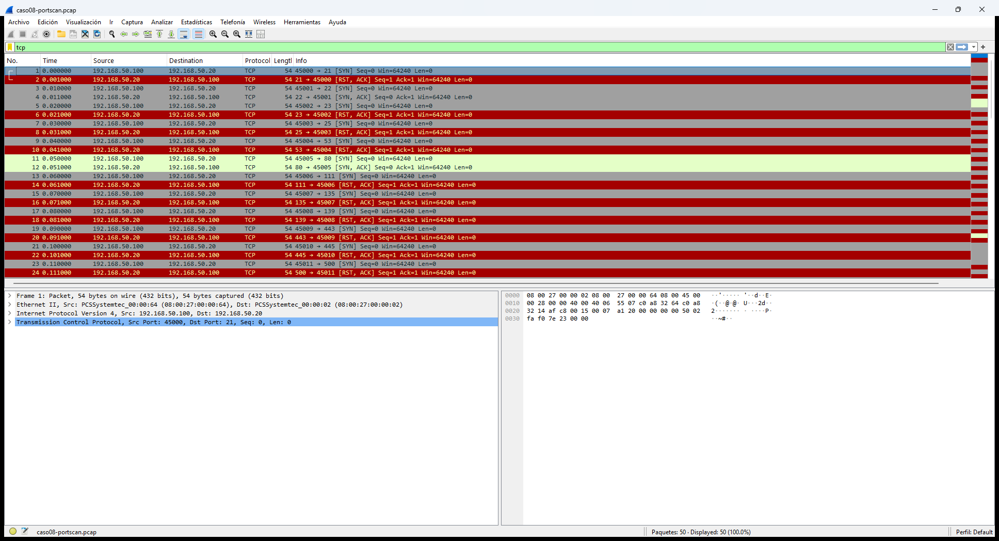
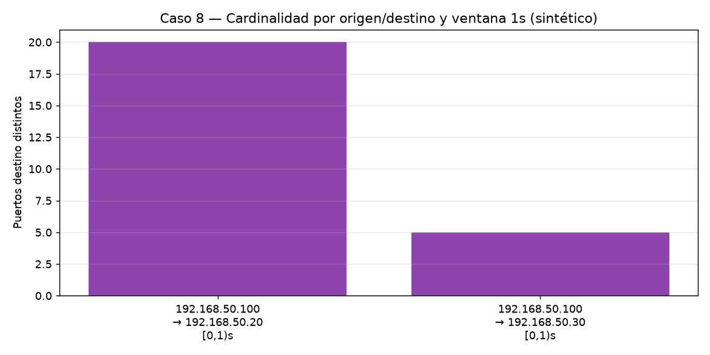

# Ficha PROVISIONAL — CASO-08: Cardinalidad de puertos

Nueve campos y preguntas propuestos; no transcripción de la guía original.

1. **ID:** CASO-08.
2. **Título:** Sondeos SYN sintéticos y lista parcial programada.
3. **Fecha y analista:** 2026-11-18; revisión del laboratorio autorizado.
4. **Categoría:** Estudio de reconocimiento TCP, no descubrimiento real.
5. **Descripción:** `.100` emite 25 SYN:20 hacia `.20` y5 hacia `.30`.
   Son24 números de puerto únicos globales porque80 aparece en ambos destinos;
   hay25 pares destino/puerto. El generador programa respuestas, no escanea VMs.
6. **Severidad:** Media potencial para reconocimiento no autorizado; sin impacto
   ni intención maliciosa real comprobados en el escenario offline autorizado.
7. **Evidencias:** `evidencia/casos/caso08-portscan.pcap`, `caso08-analisis.txt`,
   `caso08-portscan.png` (sintéticos/derivados); `caso08-regla-portscan.nft`
   (propuesta); `caso08-wireshark.png` (histórico). El ss real de caso3 solo
   sirve de inventario independiente, no valida este escaneo artificial.
8. **Observables:** 25 SYN, **21 RST y4 SYN-ACK**. Respuestas SYN-ACK programadas:
   `.20:22,80` y `.30:5222,5269`; no se completa handshake.
9. **Estado:** Patrón de sondeo sintético; lista parcial, no exposición real confirmada.

## Indicadores y análisis

Ejecutar offline `scripts/gen_caso08_portscan.py` y `scripts/analizar_caso08.py`.
SYN inicial: `tcp.flags.syn == 1 && tcp.flags.ack == 0`.
El análisis diferencia conteos y conjuntos únicos, por **ventana/origen/destino**.
Reporta ventanas fijas [inicio,fin) de0.1 s y1 s; en [0,1), `.100 → .20`
tiene20 SYN/20 puertos y `.100 → .30` tiene5 SYN/5 puertos. Retransmitir un mismo
puerto aumenta conteo, no cardinalidad. Ventanas fijas pueden partir un patrón.

La lista programada es **parcial**: no incluye sondeo SSH `.30:22`, aunque ese
socket sí consta en ss real del caso3. La coincidencia parcial con servicios del
inventario no demuestra que hubo descubrimiento o verificación de accesibilidad.
La propuesta >=20 puertos por origen/destino en1 s es un criterio didáctico de
revisión, no un umbral de ataque validado ni prueba de intención.

## Control propuesto, no aplicado

`caso08-regla-portscan.nft`: tabla independiente `caso08_observacion`, input
**en los endpoints `.20`/`.30`**, policy accept y sin drop general.
`limit rate 5/second burst 10 packets` está **antes de log**, por lo que limita
la escritura. Registra SYN de cualquier puerto, no supone puertos cerrados.
El límite es agregado; el log pierde eventos y no sirve para cardinalidad exacta.
La cardinalidad se calcula sobre PCAP completo con Python, no con un simple
threshold de cantidad de SYN. Gateway no ve tráfico directo entre peers.

Validación `nft -c -f /dev/stdin` sobre nftables1.0.9 por SSH en gateway:
exit0, stdout/stderr vacíos; no aplicación ni prueba funcional en endpoints.

## Preguntas PROPUESTAS (no originales de la guía)

- **¿25 SYN son25 puertos únicos?** No:80 se repite entre destinos, y las
  retransmisiones también pueden inflar el conteo sin aumentar cardinalidad.
- **¿SYN-ACK del PCAP confirma un puerto real abierto?** No, está programado.
- **¿El limit del log detecta escaneo?** No; controla volumen de logs, no calcula
  cardinalidad ni determina intención.

## Trazabilidad y evidencia visual

Versiones anteriores en `evidencia/casos/revision-anterior/`; evidencia histórica
preservada. `caso08-wireshark.png` es histórico; el pantallazo nuevo muestra el
PCAP corregido, generado a archivo y nunca enviado a las VMs.
Hashes finales en el manifiesto y bloque anexado a `evidencia.log`.

