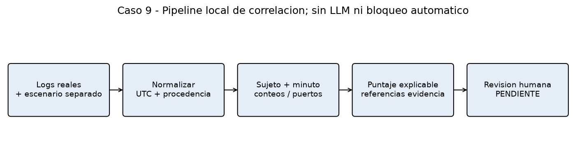
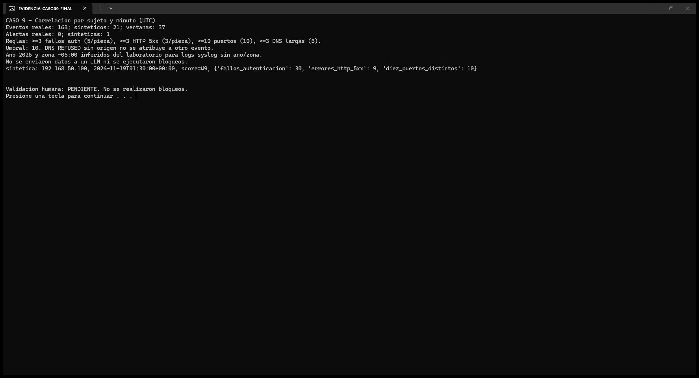

# Ficha — CASO-09: correlación local de eventos

## Nueve campos provisionales

1. **ID:** CASO-09.
2. **Título:** correlación de logs con puntaje explicable.
3. **Fecha/analista:** 2026-11-18, host analista; revisión humana del grupo pendiente.
4. **Categoría:** detección defensiva por host origen y ventana de 60 segundos.
5. **Hallazgo:** 168 eventos reales normalizados y 21 registros de prueba sintéticos producen 37 ventanas. La ejecución final obtiene 0 alertas reales y 1 alerta sintética de puntaje 49. Esto no demuestra ausencia de incidentes fuera de las muestras exportadas.
6. **Severidad:** alta para el escenario didáctico de múltiples indicadores; no se ha confirmado un incidente real.
7. **Evidencia:** `caso09-logs/`, `caso09-eventos-normalizados.csv`, `caso09-escenario-sintetico.jsonl`, `caso09-cobertura.json`, `caso09-caracteristicas.json`, `caso09-alertas.json`, `caso09-scores.txt`, `caso09-pipeline.png`, `caso09-consola-final.png`. Integridad en el manifiesto final y `evidencia.log`.
8. **Observables:** origen sintético 192.168.50.100, 6 fallos de autenticación, 3 errores HTTP 5xx y 12 puertos distintos en un minuto, correlacionados entre auth, nginx y nftables.
9. **Estado:** pipeline probado automáticamente; dictamen humano PENDIENTE, consignado en `caso09-validacion-humana.json`.

## Método reproducible

Ejecutar desde `lab`: `python scripts/caso09_siem.py`.

Cada registro conserva archivo, línea, SHA-256, fuente, host que informa y origen observado. Logs syslog sin año/zona se interpretan como 2026 y UTC−05:00 según el entorno documentado, no como información explícita del registro. Se convierten las ventanas a UTC; el escenario a las 20:30 locales corresponde a 01:30 UTC del 19 de noviembre.

Se agrupan por **procedencia real/sintética, IP origen y minuto**. Cuando el log no aporta origen, se usa un grupo no atribuido del servidor; nunca se asigna automáticamente la IP de otra línea. Los eventos sintéticos no se mezclan con los reales. La cobertura contabiliza líneas no interpretadas.

El archivo de nftables real tiene cero registros en el fragmento exportado: el firewall existente no registra estos eventos. El parser se valida con **logs nftables sintéticos**, no con un ataque en vivo. Prosody distingue correctamente conexión de desconexión. Los REFUSED DNS y las sesiones sudo se conservan como contexto, sin tratarlos automáticamente como intrusión.

## Regla de detección y controles

- Tres o más AUTH_FAIL: 5 puntos por evento.
- Tres o más HTTP 5xx: 3 puntos por evento.
- Diez o más puertos destino distintos registrados en SYN: 10 puntos.
- Tres o más consultas con etiqueta DNS >30 caracteres: 6 puntos.
- Alerta al sumar 10 o más puntos en la ventana.

Los umbrales son didácticos y requieren calibración independiente. La alerta muestra factores, fuentes, hosts y referencias verificables; recomienda revisar, **no bloquea ni modifica el firewall**. La sintética obtiene 30 + 9 + 10 = 49 puntos.

## Preguntas propuestas de análisis

- **¿Qué aporta correlacionar?** Permite reunir señales de diferentes servicios para el mismo origen y minuto sin afirmar causalidad por mera coincidencia.
- **¿Cómo se evitan atribuciones falsas?** Manteniendo el origen desconocido cuando falta, y separando siempre registros reales de simulados.
- **¿Qué puede hacer un LLM?** Resumir alertas previamente anonimizadas tras autorización; no validar autenticidad, ejecutar bloqueos ni sustituir revisión humana. Aquí no se usó un LLM externo ni se transmitieron logs.
- **¿Es equivalente a un SIEM de producción?** Es una demostración local de normalización/correlación, sin ingestión continua, retención robusta, RBAC o operación de producción; su aceptación académica corresponde al docente.

## Evidencias visuales

## Límites y validación

Los logs reales son fragmentos de horas y servicios distintos, no una campaña de ataque correlacionada. La regla de puertos cuenta destinos en conjunto dentro de la ventana y no sustituye una investigación por servicio. No hay validación humana firmada; el grupo debe completar revisor, fecha y dictamen conservando el registro anterior. Los nueve campos y preguntas son provisionales: no se dispuso del apartado 7 literal de la guía.
