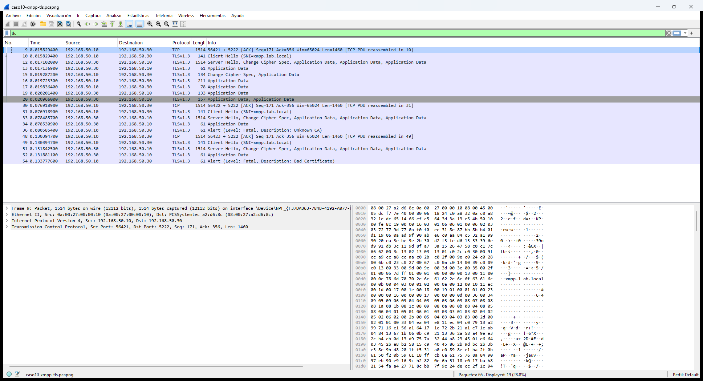
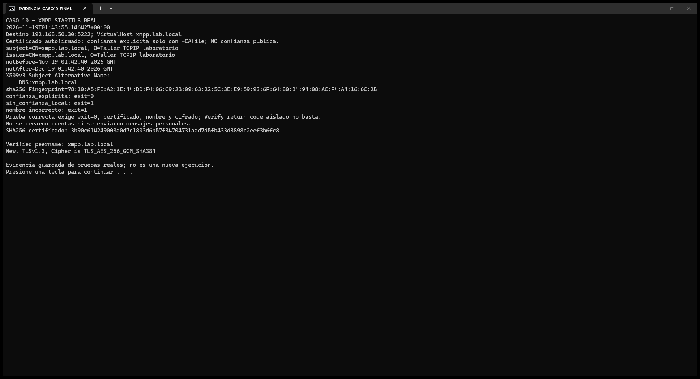

# Ficha — CASO-10: XMPP con STARTTLS real

## Nueve campos provisionales

1. **ID:** CASO-10.
2. **Título:** negociación TLS, identidad y confianza del servidor XMPP.
3. **Fecha/analista:** 2026-11-18, analista Windows; marcas UTC del 19 de noviembre equivalen a la noche del 18 en UTC−05:00.
4. **Categoría:** protección del transporte y validación de certificados.
5. **Hallazgo:** el estado inicial de Prosody carecía de certificado y no completaba TLS. Tras añadir el VirtualHost `xmpp.lab.local`, una conexión con confianza explícita negoció TLS 1.3; las pruebas sin confianza local y con nombre incorrecto fueron rechazadas.
6. **Severidad:** media para la configuración inicial incompleta; no se observó una explotación ni se prueba seguridad integral del servicio.
7. **Evidencia:** estado inicial, aprovisionamiento, certificado público, tres pruebas OpenSSL, características pre-TLS, logs, PCAP y pantallazos enumerados abajo. Integridad en el manifiesto final y `evidencia.log`.
8. **Observables:** `192.168.50.30:5222`, SNI/SAN `xmpp.lab.local`, TLS 1.3, `TLS_AES_256_GCM_SHA384`; alertas de rechazo `Unknown CA` y `Bad Certificate`.
9. **Estado:** comprobaciones técnicas positivas y negativas realizadas; localhost sigue sin certificado. Autenticación de usuarios, federación y validación académica no evaluadas.

## Estado inicial y cambio acotado

`caso10-antes.json` conserva el diagnóstico previo: servicio activo y puerto abierto, pero solo VirtualHost localhost y sin certificado disponible. Un puerto abierto o `Verify return code: 0` junto con `Cipher NONE` **no demuestra** una sesión TLS válida.

Se creó exclusivamente un VirtualHost de laboratorio y un certificado autofirmado RSA 2048 / SHA-256, con SAN DNS y EKU serverAuth. No se crearon usuarios ni se modificó la confianza de Windows. La clave privada permanece en la VM, con propietario root:prosody y modo 640; no se exportó.

Configuración añadida en la VM (`/etc/prosody/conf.d/taller-tls.cfg.lua`):

```lua
VirtualHost "xmpp.lab.local"
    authentication = "internal_hashed"
    c2s_require_encryption = true
    allow_unencrypted_plain_auth = false
    ssl = {
        certificate = "/etc/prosody/certs/xmpp.lab.local.crt";
        key = "/etc/prosody/certs/xmpp.lab.local.key";
    }
```

La recarga inicial no activó el nuevo host; se efectuó después un reinicio de Prosody. El JSON de aprovisionamiento conserva honestamente la orden original de recarga y los logs conservan el reinicio posterior. El script actual usa reinicio al aprovisionar. **No repetir `--provisionar`**: los archivos ya existen y el script rechaza sobrescribirlos.

## Certificado y cadena de confianza

| Propiedad | Valor observado |
|---|---|
| Subject / issuer | `CN=xmpp.lab.local, O=Taller TCPIP laboratorio` (autofirmado) |
| SAN | `DNS:xmpp.lab.local` |
| Inicio UTC | 2026-11-19 01:42:40 |
| Vencimiento UTC | 2026-12-19 01:42:40 (30 días) |
| Huella SHA-256 del certificado DER | `78:10:A5:FE:A2:1E:44:DD:F4:06:C9:2B:09:63:22:5C:3E:E9:59:93:6F:64:80:B4:94:08:AC:F4:A4:16:6C:2B` |
| SHA-256 del archivo PEM | `3b90c614249008a0d7c1803d6b57f34704731aad7d5fb433d3898c2eef3b6fc8` |

Las dos huellas no tienen que coincidir: una resume el certificado DER y la otra los bytes del fichero PEM. Se exportó solamente el certificado público. `-CAfile` lo acepta explícitamente para esa invocación; no establece confianza pública ni modifica el almacén del sistema.

## Pruebas y resultados

Base de las órdenes ejecutadas desde el host con OpenSSL 3.5.7 (Git):

```text
openssl s_client -starttls xmpp -xmpphost xmpp.lab.local -connect 192.168.50.30:5222 -servername xmpp.lab.local -showcerts
```

| Variante | Argumentos adicionales | Salida | Resultado |
|---|---|---:|---|
| Confianza explícita | `-CAfile caso10-certificado.pem -verify_hostname xmpp.lab.local -verify_return_error` | 0 | `Verified peername: xmpp.lab.local`, TLS 1.3 y cifrado negociado |
| Sin confianza local | `-verify_hostname xmpp.lab.local -verify_return_error` | 1 | Rechazo del certificado autofirmado; alerta Unknown CA |
| Nombre incorrecto | `-CAfile caso10-certificado.pem -verify_hostname otro.lab.local -verify_return_error` | 1 | Rechazo de identidad; alerta Bad Certificate |

Las rutas completas y salidas están en `caso10-pruebas.json` y en los TXT de cada prueba. Se envió únicamente apertura/cierre benigno del stream XMPP, sin autenticación ni mensajes personales. Una prueba adicional de características previas al cifrado observó STARTTLS con `<required/>` y ninguna oferta `PLAIN` (`caso10-pre-tls.txt`). Esta observación no reemplaza una prueba de login.

El servicio estaba activo y `prosodyctl check config` pasó. **`prosodyctl check certs` global devolvió 2**: localhost conserva la ausencia de certificado y el certificado de laboratorio vence dentro de un mes. No se presenta como una comprobación global satisfactoria.

## PCAP y correlación visual

Captura real de 20 segundos en Ethernet 2, interfaz 5 de dumpcap, limitada a `host 192.168.50.30 and tcp port 5222`; archivo `caso10-xmpp-tls.pcapng`, 66 frames. Filtro de visualización: `tls`.

- Frames 10, 31 y 49: ClientHello con SNI `xmpp.lab.local`.
- Frame 12 y posteriores: ServerHello y registros cifrados de la sesión aceptada.
- Frame 36: alerta fatal Unknown CA.
- Frame 54: alerta fatal Bad Certificate.
- Prosody registra `Stream encrypted (TLSv1.3 with TLS_AES_256_GCM_SHA384)` y los dos rechazos correspondientes.

En TLS 1.3, la etiqueta Application Data también puede contener mensajes de negociación cifrados; **no prueba que se enviaran mensajes de usuario**. No se almacenaron secretos de sesión ni se descifró contenido.





## Regla de revisión defensiva

Marcar como configuración incompleta si falta certificado, expira, no coincide el SAN o no se exige STARTTLS antes de autenticación. Validar siempre código de salida, certificado, nombre y cifrado; un puerto 5222 abierto no basta. Investigar alertas de certificado junto con los logs del servidor: en este caso las dos alertas son **controles negativos deliberados**, no incidentes.

No se aplica bloqueo automático. Para otra ejecución deben revisarse fecha de vigencia y huella por un canal de confianza; no desactivar la validación para ocultar un fallo.

## Reproducción y archivos

Desde `lab`, `python scripts/caso10_tls.py` repite las pruebas benignas contra la VM existente y guarda resultados. Respaldar los artefactos vigentes antes de repetir; la reproducción produce evidencia nueva. La captura PCAP se realiza por separado. OpenSSL del servidor es 3.0.13, registrado en el estado del servicio.

Artefactos en `evidencia/casos/`: `caso10-antes.json`, `caso10-aprovisionamiento.json`, `caso10-estado-servicio.json`, `caso10-pruebas.json`, `caso10-certificado.pem`, `caso10-certificado.txt`, `caso10-confianza_explicita.txt`, `caso10-sin_confianza_local.txt`, `caso10-nombre_incorrecto.txt`, `caso10-resumen.txt`, `caso10-pre-tls.txt`, `caso10-prosody-log.txt`, `caso10-xmpp-tls.pcapng` y ambos PNG.

## Preguntas propuestas y límites

- **¿Cifrado equivale a identidad confiable?** No: también hay que verificar nombre, cadena y vigencia; aquí la confianza fue explícita y local.
- **¿Por qué fallan dos pruebas?** Son controles negativos esperados que demuestran rechazo sin confianza y con identidad incorrecta.
- **¿Qué ve Wireshark?** Direcciones, tiempos, SNI visible y registros TLS; no el contenido cifrado sin secretos.
- **¿Qué falta evaluar?** Login real, autorización, federación s2s en 5269, localhost y gestión de renovación. La configuración c2s no demuestra cifrado extremo a extremo de mensajes.

Los nueve campos y preguntas son provisionales: no se dispuso del apartado 7 literal de la guía. La revisión humana y aceptación del docente no se sustituyen por esta ejecución automática.
